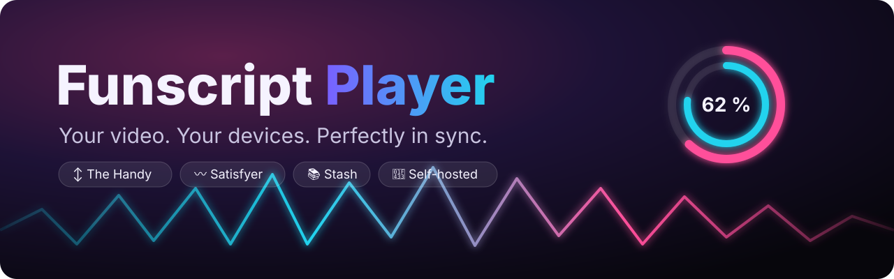

<p align="center"></p>

<p align="center"><a href="../../releases/latest"><b>Download</b></a> · <a href="CHANGELOG.md"><b>Änderungen</b></a> · <a href="DEVELOPMENT.md"><b>Entwickler-Doku</b></a> · <a href="README.md"><b>🇬🇧 English</b></a></p>

# Funscript Player

Selbst gehosteter Web-Player: spielt deine Videos (Stash oder Ordner) und steuert **The Handy** und den **Satisfyer**
synchron aus demselben Funscript. Keine externen Abhängigkeiten, ein kleiner Docker-Container.

## Schnellstart (Docker)

```bash
unzip handy-player-linux-vX.Y.Z.zip && cd handy-player
cp .env.example .env      # einmal: STASH_URL, ggf. Port und Medienordner eintragen
nano .env
docker compose pull && docker compose up -d
docker logs Funscript-Player  # Start-Übersicht mit Selbsttest (englisch), endet mit „✓ ready“
```

- Erreichbar unter `http://<server>:8080` (`PLAYER_PORT` in der `.env`). Für **HTTPS** – nötig für Bluetooth und
  „Als App installieren“ – einen beliebigen Reverse Proxy davor setzen (Traefik, Caddy, nginx, Nginx Proxy Manager …),
  z. B. `https://funscript-player.example.com` → Port 8080 des Containers.
- **Update:** `docker compose pull && docker compose up -d` – das fertige Image kommt von GitHub
  (`ghcr.io/scripthost/funscript-player`). Selbst bauen: `docker compose up -d --build`. Vorab testen, was kommt:
  `PLAYER_VERSION=edge` in der `.env` folgt dem neuesten getesteten Stand von `main` (kein Release, ändert sich oft).
- Alle Server-Einstellungen stehen in der **`.env`**; die `docker-compose.yml` liest sie nur. Updates überschreiben die `.env` nie.
- **Stash** am besten direkt über ein gemeinsames Docker-Netz ansprechen, z. B. `STASH_URL=http://Stash:9999`
  (Containername). Der Player gibt keine Stash-Adressen an den Browser weiter – ein öffentlicher DNS-Name ist nicht nötig.
- Der Container läuft als Benutzer `node` (1000), **nie als root**; `PUID`/`PGID` ändern das. `PLAYER_MEM` (Standard 2g)
  begrenzt den Arbeitsspeicher – läuft der Player voll, trifft es nur ihn, nicht Stash.
- **HQ-Stream:** `/dev/dri` wird durchgereicht, `RENDER_GID` = GID der Host-Gruppe `render` (`getent group render`).

### Update von 1.19.6 oder älter: Container und Volume heißen jetzt anders

Seit 1.19.7 heißt der Container `Funscript-Player` und das Volume `funscript-data` (vorher `Handy-Player` und
`<Ordner>_handy-data`). Ein neues Volume startet leer – die alten Daten (Key, Einstellungen, eigene Scripts) einmal
hinüberkopieren:

```bash
docker volume ls | grep handy-data          # alten Namen finden, z. B. handy-player_handy-data
docker stop Handy-Player && docker rm Handy-Player
docker volume create funscript-data
docker run --rm -v handy-player_handy-data:/from -v funscript-data:/to alpine cp -a /from/. /to/
docker compose pull && docker compose up -d
```

Läuft alles, kann das alte Volume weg: `docker volume rm handy-player_handy-data`.

### Was liegt im Volume `funscript-data`?

Alles, was der Player selbst speichert – eine Sicherung dieses Volumes ist eine Sicherung von allem.
Wird es gelöscht, startet der Player wirklich neu (auch die Browser vergessen dann die gemeinsamen Einstellungen).

| Datei | Inhalt |
|---|---|
| `prefs.json` | Gemeinsame Einstellungen aller Geräte: Connection Key, Application ID, Offsets und Hub je Szene, Script-Intensität, Satisfyer-Übersetzung, Notaus … |
| `store.json` | Patterns (🎮 Steuern → Patterns) |
| `settings.json` | Server-Schalter aus der Oberfläche: HereSphere an/aus, „nur VR“, HereSphere-Passwort (als scrypt-Hash), Intiface nur Heimnetz |
| `scripts/` + `userscripts.json` | Eigene Scripts (Touch-Aufnahmen, Mitschnitte) zu Stash-Szenen und das Verzeichnis aller eigenen Scripts |
| `handy-cache.json` | Merkliste schon hochgeladener Scripts (schnellerer Start) |

Pro Gerät (im Browser) bleiben nur Bild/HQ, Sprache, Kopfzeile, Bildschirmsperre und geöffnete Bereiche.

## Aufbau

- **Status oben antippen** öffnet das Geräte-Fenster – Handy verbinden (Connection Key und Application ID gleich dort
  unter „🔑 Verbindung“), ⟳ Neu synchronisieren, Satisfyer per Bluetooth.
  Wird die Handy-Cloud langsam, wird der Status gelb.
- **Am Video** stehen nur die Regler der verbundenen Geräte: Script-Intensität (Automatisch zuerst), Offset (zugeklappt, antippen für −/+), Hub der Handy, Stärke min/max
  und Übersetzung des Satisfyers, Finale, Pause, Alles stoppen.
- **Script-Intensität** – eine Auswahl für Handy und Satisfyer, pro Szene am Video (vier Knöpfe mit Mini-Heatmap);
  Standard unter ⚙️ → Script:
  - **Original** – genau die Datei
  - **Automatisch** – streckt kleinen Hub, passt an, was die Handy nicht schafft (bleibt exakt im Takt)
  - **Sanft** – Hub 20–80 %, höchstens 240 %/s, Satisfyer schwächer und ruhiger
  - **Intensiv** – voller Hub, ruhige Stellen im doppelten/dreifachen Takt, Satisfyer kräftiger
- Der Satisfyer braucht **kein eigenes Vibrations-Script** – er nutzt dasselbe Funscript wie die Handy. Springt oder lädt
  das Video, ruhen beide Geräte. **Mehrere Satisfyer** gleichzeitig: jeder mit eigener Stärke und eigenem Vorlauf; bei zwei
  Motoren folgt Motor 2 auf Wunsch dem Tempo. Die Geräte-Liste zeigt ⏱ die Bluetooth-Laufzeit, schwankt sie, wird der Status gelb.
- **Videos ohne Funscript:** „Selbst steuern“ (Tempo, Hub unten/oben, Satisfyer-Stärke, Touch-Fläche) und
  **⏺ Mitschnitt zum Video** als eigenes Script (Ordner: daneben, wenn ohne `:ro` eingebunden; Stash: im Volume).
- **Vollbild:** Doppeltippen links/rechts springt 5/10 s, gedrückt halten = 2× bzw. rückwärts. **Wischen** hoch/runter
  je Bildhälfte (Standard: links Hub Handy, rechts Stärke Satisfyer; auch Lautstärke oder beide Geräte – ⚙️ → Anzeige).
- **Status, der stimmt:** „verbunden“ wird beim Zurückkommen und jede Minute wirklich geprüft und bei Bedarf neu
  verbunden. Reißt ein Gerät mitten im Video ab, hält das Video an (⚙️ → Notaus). 🔋 Akku der Satisfyer in der Geräte-Liste.
- **Wie eine App:** „📲 Als App installieren“ (⚙️ → Anzeige, auch im Willkommen) oder im Browser „ganze App im Vollbild“.
  App verlassen, während das Video läuft = Bild-in-Bild (sofern der Browser es zulässt).
- **🎮 Steuern:** Direktsteuerung, Touch-Fläche (Tempo oder 🧪 Position) und Pattern-Editor.
- **Bibliothek:** Stash-Szenen und Ordner-Videos mit Heatmap-Leiste, Intensitäts-Filter, Tags/Darsteller/Studios,
  gespeicherte Stash-Filter, „nur 2D“ je Gerät, Mini-Player beim Stöbern.
- **Einstellungen:** jeder Bereich aufklappbar, Erklärungen hinter ⓘ; „Erweiterte Einstellungen zeigen“ blendet
  Feinheiten ein. ⚙️ → System zeigt **„Update verfügbar“**, wenn es auf GitHub ein neueres Release gibt.
- **Handy-API v3:** unter ⚙️ → Handy eine *Application ID* eintragen – dann läuft die Handy auch bei 0,5×–2× mit.

## Notaus

- Esc-Taste oder „■ Alles stoppen“ im Geräte-Fenster (Status oben) halten Video, Handy, Patterns und Satisfyer sofort an – immer.
- Seit 1.19.8 standardmäßig aus, unter ⚙️ → Notaus einschaltbar: rote STOPP-Knöpfe am Video (schwebend, oben im Vollbild,
  „Alles stoppen“ unter dem Video) und Stopp bei Bildschirmsperre / App-Wechsel.
- **Auto-Stopp:** keine Bedienung und kein laufendes Video → nach 5/10/20/30 Minuten alles aus (⚙️ → Notaus, Standard: nie).
- Grenzen: max. Geschwindigkeit der Direktsteuerung, „Maximum“ beim Satisfyer.

## Selbsttest

Beim Start prüft sich der Container selbst – Datenordner, gespeicherte Dateien, alle Skripte der Oberfläche, jedes
Bedienelement und die Script-Intensität. Das Ergebnis steht in `docker logs` („Self-test: 9/9 ok“). Die Oberfläche
prüft sich beim Laden still und meldet nur Fehler an den Server. `?selbsttest` spielt typische Abläufe mit einer
simulierten Handy durch – seit 1.19.9 automatisch vor jedem Release in Chrome auf GitHub, zusammen mit einem
Übersetzungs-Test und ESLint.

## Ordner einbinden

Jeder Ordner unter `/media/<Name>` wird eine eigene Quelle – in der `docker-compose.yml` weitere Zeilen unter `volumes`,
z. B. `- /srv/downloads:/media/Downloads:ro`. Video und Script brauchen denselben Namen (`Name.mp4` + `Name.funscript`).

## VR-Brille (HereSphere)

In HereSphere im Browser `https://<player>/heresphere` öffnen. Standardmäßig nur VR-Videos; Kategorien *Alle mit Script*,
gespeicherte Stash-Filter und Ordner. Die Handy steuert HereSphere selbst (Connection Key dort eintragen). Eine Anmeldung
im Reverse Proxy muss für `/heresphere` ausgenommen sein; optional schützt ein Passwort die Schnittstelle. Abschaltbar
unter ⚙️ → VR oder fest mit `HERESPHERE=off`. Mit Passwort meldet man sich einmal an; ein neues Passwort meldet alle Geräte ab.

## Bild

„Automatisch“ rechnet kleine Videos auf dem Server hoch (Intel Quick Sync / VAAPI, sonst CPU) und entrauscht leicht; im
Browser nur ein Hauch Schärfe (WebGL, AMD CAS) und Farbtreppen glätten – Farben und Kontrast bleiben wie im Original.
„Schärfer“/„Maximal“ bzw. HQ „Sauber“/„Stark“ für mehr. Kein KI-Upscaling.

## Satisfyer

Direkt per Bluetooth aus dem Browser (Chrome/Edge auf Android/PC, iPhone: App „Bluefy“) – braucht HTTPS.
Alternativ über **Intiface Central** (auch: Handy per Bluetooth ohne Internet); bei HTTPS leitet der Server die
Verbindung über `/intiface` weiter (standardmäßig nur Heimnetz, mit `INTIFACE_LAN_ONLY=1` fest; nur Port 12345, weitere über `INTIFACE_PORTS`).

## Sicherheit

- Keine Anmeldung im Player als Standard – hinter einem geschützten Proxy oder nur im Heimnetz betreiben, oder
  `AUTH_USER`/`AUTH_PASS` setzen (Basic Auth).
- Der Server nimmt Änderungen nur von der eigenen Seite an (Herkunftsprüfung) und lässt sich nicht einbetten.
- Der Container läuft schreibgeschützt, mit `/tmp` als tmpfs, ohne Linux-Rechte (`cap_drop: ALL`) und mit
  `no-new-privileges`; schreiben kann er nur in sein Daten-Volume.
- Eine strenge Content-Security-Policy erlaubt nur die eigenen Skripte des Players.
- HereSphere-Passwort als scrypt-Hash gespeichert; ein neues Passwort meldet alle Geräte ab.

## Entwicklung

```bash
MEDIA_DIR=./testmedia DATA_DIR=./data node server.js   # → http://localhost:8080
node --test "test/*.test.js"                           # automatische Tests, ohne Pakete
```

Technische Details: [DEVELOPMENT.md](DEVELOPMENT.md) (englisch). Änderungen: [CHANGELOG.md](CHANGELOG.md) (englisch).

## ❓ Häufige Fragen / Fehlerhilfe

- **„Handy ist nicht online“** – die Handy muss im WLAN-Modus und mit dem Internet verbunden sein (LED blau) und der
  Connection Key stimmen (⚙️ → Geräte). Einschalten, dann oben auf den Status tippen → *Verbinden*.
- **Der Satisfyer taucht nicht auf** – Bluetooth im Browser braucht **Chrome oder Edge** (Android/PC; iPhone: App
  *Bluefy*) und **HTTPS** oder `localhost`. Vorher die Satisfyer-App schließen (nur eine Verbindung möglich) und ggf.
  *Alle Bluetooth-Geräte anzeigen*.
- **Geräte liegen neben dem Takt** – Offset verschieben oder per Takt einmessen (🎯, wird je Szene gemerkt). Mit
  *Application ID* (Handy-API v3) bleibt die Handy auch bei 0,5×–2× im Takt. Gelber Status = Handy-Cloud antwortet langsam.
- **Stash nicht erreichbar** – `STASH_URL` gilt aus Sicht des Containers: im gemeinsamen Docker-Netz den Containernamen
  nehmen (z. B. `http://Stash:9999`), nicht `localhost`. Zeile `Stash:` in `docker logs Funscript-Player` prüfen.
- **HQ-Stream zeigt „CPU“ oder „nicht verfügbar“** – `/dev/dri` durchreichen und `RENDER_GID` auf die GID der Host-Gruppe
  `render` setzen (`getent group render`).
- **HereSphere fragt erneut nach dem Passwort** – Passwörter von vor 1.19.5 gelten nicht mehr; unter ⚙️ → VR einmal neu
  setzen.
- **Update** – `docker compose pull && docker compose up -d`; deine Daten bleiben im Volume `funscript-data`.

## Hinweise

- **Datenschutz:** Für die WLAN-Steuerung wird nur das Funscript (als CSV mit neutralem Namen `script.csv`) auf Handys
  Script-Hosting geladen. Videos und Titel bleiben auf deinem Server.
- **Formate:** was dein Browser kann – MP4 (H.264/H.265) und WebM überall, MKV je nach Browser; Stash-Szenen in anderen
  Formaten werden live umgewandelt.

## Wie es entsteht

Ein Hobbyprojekt, entwickelt mit Hilfe von **Claude** (Anthropic) – ein großer Teil des Codes ist KI-geschrieben. Jede
Version wird vor der Veröffentlichung durch automatische Tests, einen Browser-Selbsttest, ESLint und Code-Scanning geprüft.

## Lizenz

Copyright © 2026 Funscript Player contributors. Lizenz: **[GNU AGPL-3.0](LICENSE)** – frei nutzen, selbst hosten und
ändern; wer eine veränderte Fassung anderen anbietet – auch als Dienst im Netz –, muss deren Quellcode unter derselben
Lizenz offenlegen.
