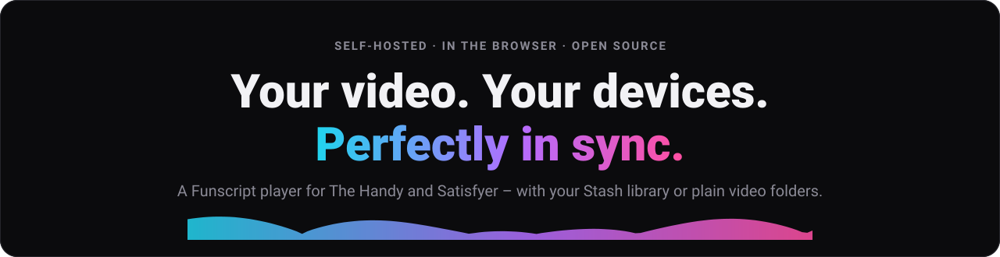
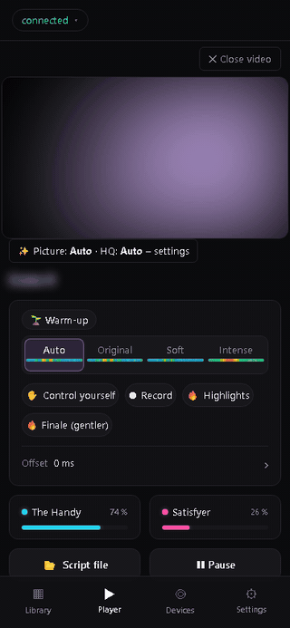
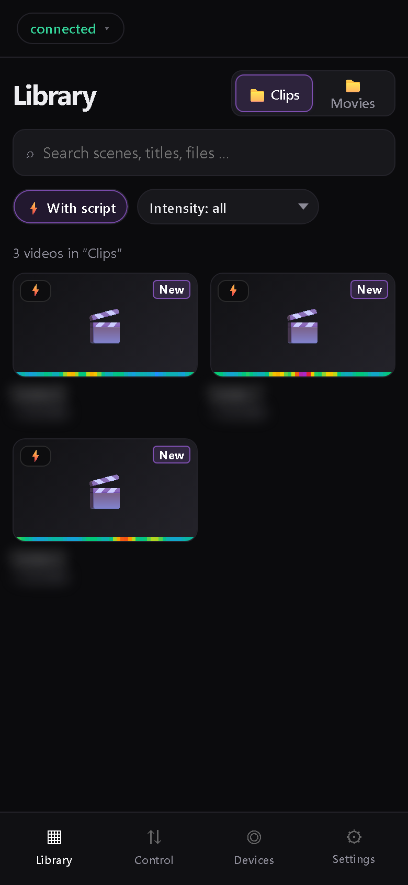
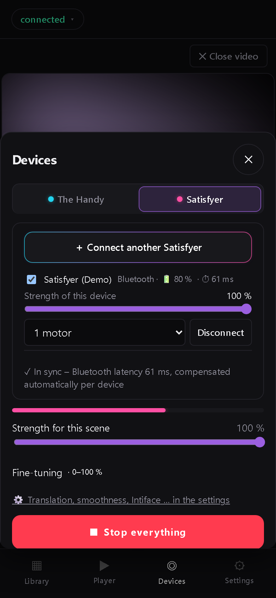
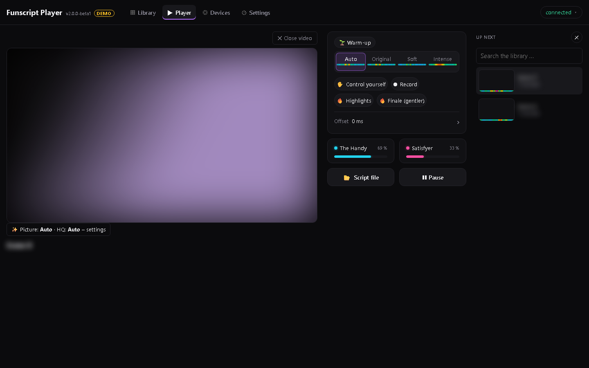

<!-- Graphics: docs/img/gh (node docs/img/gh/build.js) · screenshots + GIF: docs/img/screens (demo mode, neutral test videos) -->
<p align="center">
  <a href="../../releases/latest"></a>
</p>

<p align="center">
  <a href="#-quick-start"></a>&nbsp;
  <a href="../../releases/latest"></a>
</p>

<p align="center">
  <a href="../../releases/latest"></a>
  
  
  
  
  
  <a href="LICENSE"></a>
  <a href="https://scorecard.dev/viewer/?uri=github.com/ScriptHost/funscript-player"></a>
</p>

**Funscript Player** plays your videos in the browser and drives **The Handy** and **Satisfyer** devices in sync with
the Funscript – at the same time, from the same script. It runs on your own server in Docker, reads your
**Stash** library or plain video folders, and works on phone, tablet, PC and in VR (HereSphere).

<p align="center">
  &nbsp;
  &nbsp;
  
</p>
<p align="center"><sub>Screenshots from the built-in demo mode (<code>/demo</code>): videos, previews and names are blurred.</sub></p>

## ✨ Features

- **One script, every device** – pick the intensity once for Handy and Satisfyer: **Auto**, **Original**, **Soft**
  or **Intense**, per scene, with a mini heatmap. Several scripts per video (`clip.soft.funscript` …) switchable while playing.
- **Satisfyer with any script** – the stroke script becomes vibration live. No vibration script needed; several
  Satisfyers at once, each with its own strength.
- **Sync that stays in time** – Handy cloud with clock sync; with an *Application ID* (API v3) even at 0.5×–2×.
- **Library** – Stash scenes and folder videos with heatmap, intensity filter, 🔥 highlights, saved Stash filters,
  2D-only mode, ratings and favourites back to Stash.
- **Like an app** – install it on the home screen, swipe controls in fullscreen, picture-in-picture, mini player.
- **Your own scripts** – control the devices by hand, ⏺ record along the video, replace just a section. Originals are
  never overwritten.
- **Natural picture** – small videos are upscaled on the server (Intel Quick Sync, otherwise CPU).
- **VR** – HereSphere API for VR headsets.
- **Emergency stop** – Esc and “Stop everything” always; optional STOP buttons, stop on screen lock, auto-stop.

<p align="center"></p>

## 🚀 Quick start

You need a server with **Docker** (Linux, NAS, Raspberry Pi, Mac with Apple silicon – images for amd64 and arm64).
Grab `handy-player-linux-vX.Y.Z.zip` from the [latest release](../../releases/latest) (or clone this repo), then:

```bash
unzip handy-player-linux-vX.Y.Z.zip && cd handy-player
cp .env.example .env
nano .env                       # login, Stash address, video folder
docker compose up -d
docker logs Funscript-Player    # startup summary with self-check, ends with “✓ ready”
```

Open `http://<server>:8080`.

- **Login** – required since 2.0. Either set `AUTH_USER` + `AUTH_PASS` in `.env`, or leave them empty: the player then
  opens a **setup page** where you choose user name and password (change or remove it later in ⚙️ → Security &
  privacy). `LOGIN=off` only if a reverse proxy with its own login protects the player. Forgotten? `LOGIN_RESET=1`,
  restart, remove the line again.
- **Stash** – `STASH_URL` is seen from inside the container: on a shared Docker network use the container name
  (`http://Stash:9999`), not `localhost`. No Stash? `STASH=off`. Address and API key can also be changed in ⚙️ → Library.
- **Video folders** – `MEDIA=/path/to/videos`: every subfolder becomes a source. A video and its script share the
  name (`Name.mp4` + `Name.funscript`).
- **HTTPS** – needed for Bluetooth (Satisfyer) and “install as app”: put any reverse proxy in front (Traefik, Caddy,
  nginx, Nginx Proxy Manager …), e.g. `https://player.example.com` → port 8080. See [Security](#-security--proxy).
- **Update** – `docker compose pull && docker compose up -d`. Your `.env` and the `funscript-data` volume stay.
  Want to try what's next? `PLAYER_VERSION=edge` follows the latest tested state of `main`.
- **Intel graphics** (optional, faster HQ stream) – enable the two `/dev/dri` lines in `docker-compose.yml` and set
  `RENDER_GID` (`getent group render`). Without them the HQ stream runs on the CPU.

Everything else is optional and commented out at the bottom of `.env.example`.

## 📱 Using it

1. Tap the status at the top (or **Devices**) → connect the Handy with its connection key and/or the Satisfyer via
   Bluetooth (Chrome/Edge on Android or PC; on iPhone the *Bluefy* app).
2. Pick a scene in the library and press play. Below the video you only see the controls of connected devices.
3. If a script is off: shift the **offset** or tap along to calibrate it (saved per scene).

Settings are grouped into pages: Devices, Security & privacy, Script, Library, Picture & display, VR & HereSphere,
System. ⚙️ → System shows **“Update available”** when there is a newer release.

## 🔒 Security & proxy

- **Login is required.** Rule order: `.env` (`AUTH_USER`/`AUTH_PASS`) > login set up in ⚙️ > `LOGIN=off` > setup page.
  Passwords set in the interface are stored as scrypt hashes; 10 wrong attempts per minute lock out guessing.
- **Reverse proxy with its own login:** exclude **only `/heresphere`** (HereSphere can't do browser logins) – never
  `/stash` or `/media`. `PLAYER_BIND=127.0.0.1` publishes the port only on the server itself, so nobody gets past
  the proxy.
- **HereSphere** is off by default. If you switch it on, give it its own password (⚙️ → VR & HereSphere) – without
  one, the `/heresphere` exception in your proxy is an open door to your library. Its token in the URL never expires;
  if it leaks, set a new password (that logs out all devices).
- The server only accepts changes from its own page (origin check), can't be embedded in other sites and serves a
  strict Content Security Policy.
- The container runs as user `node` (never root), read-only, without Linux capabilities, with `no-new-privileges`
  and a memory cap (`PLAYER_MEM`, default 2g). It only writes to its data volume.
- Intiface relay: home-network addresses and port 12345 only (`INTIFACE_LAN_ONLY`, `INTIFACE_PORTS`).

Found a vulnerability? See [SECURITY.md](SECURITY.md).

## 🛡 Privacy

- **The container needs no internet access.** It only talks to Stash and serves the player to your browser. The only
  exception is the optional update check (GitHub, at most every 6 h) – `UPDATE_CHECK=off` switches it off.
- **The Handy over Wi-Fi goes through the Handy cloud (handyfeeling.com).** Your browser – not the server – sends
  your connection key and the **Funscript of the current video** there, because the Handy plays scripts from the
  cloud. The script is uploaded as a CSV with the neutral name `script.csv`; videos and titles stay on your server.
- The connection key is stored on your player server so all your devices know it.
- **Satisfyer** connects via Bluetooth from the browser or through Intiface Central in your home network – no cloud.
  The Handy can also run via Bluetooth through Intiface, then without the Handy cloud.

## 📚 Stash 0.32+

Stash 0.32 rejects requests from networks it considers public when Stash has no login – the player then shows
**“HTTP 403”**. Some Docker networks count as public. Two ways out:

- Allow the player's network in Stash's `config.yml`, e.g. `public_whitelist: ["172.18.0.0/16"]`, and restart Stash.
  The player shows the exact line for your network in ⚙️ → Library and in `docker logs`.
- Or set a user + password in Stash and put its API key into `STASH_API_KEY` (or ⚙️ → Library). The key never
  leaves the player server.

⚙️ → Library shows the connection status and has a **Test connection** button; the player retries every 30 s.

## 🥽 VR (HereSphere)

Switch it on in ⚙️ → VR & HereSphere, then open the player's normal address in HereSphere – it is redirected to
`/heresphere` automatically. VR videos by default; categories for all scenes with scripts, saved Stash filters and
folders. HereSphere drives the Handy itself (enter the connection key there). `HERESPHERE=off` switches it off for good.

## 💾 Data

Everything the player stores lives in the `funscript-data` volume – back it up and you have backed up everything:
settings shared by all devices (`prefs.json`), patterns (`store.json`), server switches and login hashes
(`settings.json`), your own scripts (`scripts/`, `userscripts.json`) and the Handy upload cache.

<details>
<summary>Upgrading from 1.19.6 or older (container and volume were renamed)</summary>

Since 1.19.7 the container is called `Funscript-Player` and the volume `funscript-data` (before: `Handy-Player` and
`<folder>_handy-data`). Copy your old data over once:

```bash
docker volume ls | grep handy-data          # find the old name, e.g. handy-player_handy-data
docker stop Handy-Player && docker rm Handy-Player
docker volume create funscript-data
docker run --rm -v handy-player_handy-data:/from -v funscript-data:/to alpine cp -a /from/. /to/
docker compose pull && docker compose up -d
```
</details>

<details>
<summary>Upgrading from 1.19 to 2.0</summary>

- Take the new `docker-compose.yml` and compare your `.env` with the new `.env.example`. Video folders are now one
  line: `MEDIA=/path` (its subfolders become sources) instead of `MEDIA_FILME`, `MEDIA_DOWNLOADS` … – or keep your own
  extra volume lines.
- Set a login (`AUTH_USER`/`AUTH_PASS`) or use the setup page on first start.
- Behind a reverse proxy: remove the exceptions for `/stash` and `/media`, keep only `/heresphere`.
- HereSphere users: reload the library in HereSphere once (addresses changed).
</details>

## ❓ FAQ / Troubleshooting

- **“Handy is not online”** – the Handy must be in Wi-Fi mode and online (LED blue) and the connection key right.
- **The Satisfyer doesn't show up** – Bluetooth in the browser needs **Chrome or Edge** (iPhone: *Bluefy*) and
  **HTTPS** or `localhost`. Close the Satisfyer app first (only one connection at a time).
- **Devices are off the beat** – shift the offset or tap along to calibrate. A yellow status means the Handy cloud
  answers slowly.
- **Stash not reachable** – check the line `Stash:` in `docker logs Funscript-Player` and ⚙️ → Library →
  *Test connection*. `HTTP 403` → see [Stash 0.32+](#-stash-032).
- **HQ stream says “CPU” or “not available”** – enable `/dev/dri` (Intel graphics only) and set `RENDER_GID`.
- **Locked out** – `LOGIN_RESET=1` in `.env`, `docker compose up -d`, log in / set up again, remove the line.

## 🛠 Development

```bash
MEDIA_DIR=./testmedia DATA_DIR=./data node server.js   # → http://localhost:8080
node --test "test/*.test.js"                           # tests incl. a browser self-test, no packages needed
```

Technical details: [DEVELOPMENT.md](DEVELOPMENT.md) · Release history: [CHANGELOG.md](CHANGELOG.md) · Want to help?
[CONTRIBUTING.md](CONTRIBUTING.md). The user interface is available in English and German.

## Trademarks & how it is made

“The Handy”, “Satisfyer”, “Stash”, “HereSphere” and “Intiface” are names of their respective owners. This is an
independent hobby project – not affiliated with, endorsed or sponsored by any of them.

Built with the help of **Claude** (Anthropic) – much of the code is AI-written. Every release is checked by automated
tests, a browser self-test, ESLint and code scanning before it goes out.

## License

Copyright © 2026 Funscript Player contributors. Licensed under the **[GNU AGPL-3.0](LICENSE)**: use, self-host and
change it freely; if you offer a modified version to others – also as a service over the network – you have to share
its source code under the same license.

---

<p align="center">
  <a href="../../releases"><b>Releases</b></a> ·
  <a href="CHANGELOG.md"><b>Changelog</b></a> ·
  <a href="DEVELOPMENT.md"><b>Developer docs</b></a> ·
  <a href="../../issues/new/choose"><b>Report a bug / idea</b></a>
</p>
