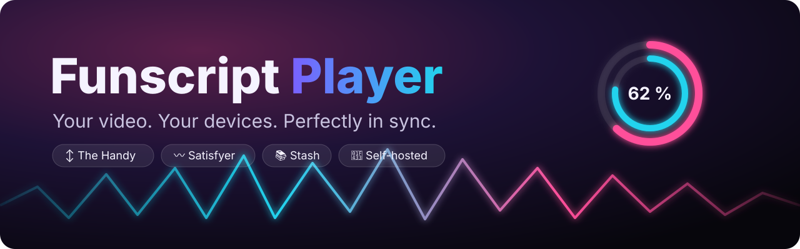
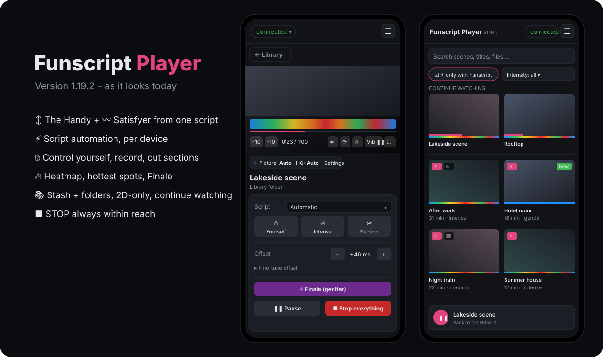

<p align="center">
  
</p>

<p align="center">
  
  
  
  
  
  
  
</p>

<p align="center">
  <a href="https://funscript-player.de"><b>Website</b></a> ·
  <a href="#quick-start"><b>Quick start</b></a> ·
  <a href="CHANGELOG.md"><b>Changelog</b></a> ·
  <a href="https://funscript-player.de/dev.html"><b>Developer docs</b></a> ·
  <a href="README.de.md"><b>🇩🇪 Deutsch</b></a>
</p>

---

**Funscript Player** is a self-hosted web player that plays your videos and drives **The Handy** and the **Satisfyer**
in sync – both from the *same* Funscript, no separate vibration script needed. Your library comes from **Stash**
and/or your own folders; watch on PC, phone, TV or in a VR headset. One small container, zero npm dependencies.

<p align="center">
  
</p>

## ✨ Highlights

| | |
|---|---|
| ⚡ **One script, every device** | Scripts play **Automatic** by default: what the Handy's motor can't manage is adapted (shorter, or full stroke at half tempo), small strokes are stretched. Prefer it untouched? Pick **original + beat guard**. |
| 〰 **Satisfyer with any script** | The stroke script becomes vibration live – by rhythm, speed or position. No vibration script needed. |
| ⏱️ **Sync that stays in time** | Handy cloud with clock sync; with an *Application ID* (API v3) even at 0.5×–2× playback. |
| ✋ **Your own scripts** | Control the devices yourself while watching (slider, quick picks, touch pad), record it as a script, replace just a section later. Originals are never overwritten. |
| 📚 **Library** | Stash scenes and folder videos with heatmap, intensity filter, 🔥 hottest spots, saved Stash filters, continue watching, 2D-only mode, mini player, picture-in-picture. |
| ✨ **Sharper picture** | Server-side upscaling (Intel Quick Sync / VAAPI) plus sharpening in the browser. |
| 📱 **Remote & VR** | Video on the TV, controls on the phone; HereSphere API for VR headsets. |
| 🛡️ **Safety first** | STOP button everywhere, Esc as emergency stop, devices pause when the screen locks. |

## 🚀 Quick start

Grab `handy-player-linux-vX.Y.Z.zip` from the [latest release](../../releases/latest) (or clone this repo), then:

```bash
unzip handy-player-linux-vX.Y.Z.zip && cd handy-player
cp .env.example .env      # once: set DOMAIN, STASH_URL, media folders if any
nano .env
docker compose up -d --build
docker logs Handy-Player  # startup summary ends with “✓ bereit” (ready)
```

- All server settings live in **`.env`**; `docker-compose.yml` only reads them. Updates never overwrite your `.env`.
- Player settings shared by all your devices (Handy connection key, Application ID, offsets, own scripts …) are stored
  on the server in the Docker volume **`handy-data`** (`/app/data/prefs.json`, `store.json`) – that is why they are in sync
  everywhere and survive updates. Back them up via ⚙️ → System → Backup.
- The compose file is prepared for **Traefik** (add your own labels and networks); the player runs at `https://${PLAYER_HOST}.${DOMAIN}`.
- **Media folders** are commented out by default (Stash only). To use folders, enable the volume line in
  `docker-compose.yml` and set `MEDIA_FILME` in `.env`. Every folder under `/media/<name>` becomes a source; a video and
  its script share the same name (`Name.mp4` + `Name.funscript`).
- **HQ stream:** `/dev/dri` is passed through, `RENDER_GID` = GID of the host group `render` (`getent group render`).
- The container runs as user `node` (1000), never as root; `PUID`/`PGID` change it.
- Bluetooth and “install as app” need **HTTPS with a valid certificate** (e.g. Traefik + Let’s Encrypt).

## Usage

1. Tap the status at the top → connect the Handy (connection key, optional Application ID) and/or the Satisfyer
   (Bluetooth right in Chrome/Edge, on iPhone the “Bluefy” app).
2. Pick a scene in the library and press play. Below the video you only see the controls of connected devices.
3. If a script is noticeably off: shift the **offset** or calibrate it by tapping the beat (🎯, saved per scene).

Fine-tuning (Satisfyer translation, picture, finale, display …) is under **⚙️ → Settings → Show advanced settings**.
⚙️ → System offers a **backup** (own scripts, offsets, patterns, settings) to download and restore.

## Security

- No login in the player by default – run it behind a protected proxy or in your home network only, or set
  `AUTH_USER`/`AUTH_PASS` (basic auth).
- The server only accepts changes from its own page (origin check) and can’t be embedded in other sites.
- `INTIFACE_LAN_ONLY=1` restricts the Intiface forwarding to 192.168.x / 10.x.

## Development

```bash
MEDIA_DIR=./testmedia DATA_DIR=./data node server.js   # → http://localhost:8080
node --test "test/*.test.js"                           # automated tests, no packages needed
```

Open the player with `?selbsttest` for an in-browser self-test with a simulated Handy. Technical details:
`docs/dev.html` (English/German switch). Release history: [CHANGELOG.md](CHANGELOG.md) and [release-notes/](release-notes) (German).

## Notes

- **Privacy:** for Wi-Fi control only the Funscript is uploaded to the Handy’s script hosting (as CSV with the neutral
  name `script.csv`). Videos and titles stay on your server.
- **Formats:** whatever your browser plays – MP4 (H.264/H.265) and WebM everywhere, MKV depending on the browser;
  Stash scenes in other formats are converted live.
