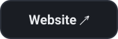
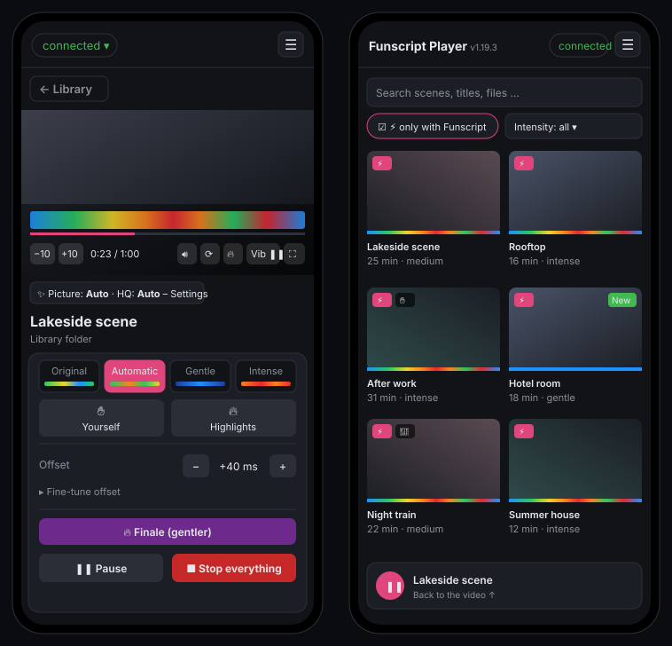

<!-- Grafiken: docs/img/gh/ (erzeugt mit `node docs/img/gh/build.js`, Stil und Texte wie funscript-player.de) -->
<p align="center">
  <a href="https://funscript-player.de"></a>
</p>

<p align="center">
  <a href="#-quick-start"></a>&nbsp;
  <a href="https://funscript-player.de"></a>&nbsp;
  <a href="../../releases/latest"></a>
</p>

<p align="center">
  
  
  
  
  
  
  <a href="README.de.md"></a>
</p>

<p align="center">
  
</p>

<p align="center">
  
</p>

<p align="center">
  
  
</p>

<p align="center">
  
  
</p>

<p align="center">
  
  
</p>

## ✨ All features

| | |
|---|---|
| 🎚 **One script, every device** | Pick the intensity once for Handy and Satisfyer: **Original** (untouched), **Automatic** (small strokes stretched, what the motor can't manage adapted – still exactly in time), **Gentle** or **Intense** – per scene right at the video, with a mini heatmap preview. |
| 〰 **Satisfyer with any script** | The stroke script becomes vibration live – by rhythm, speed or position. No vibration script needed. |
| ⏱️ **Sync that stays in time** | Handy cloud with clock sync; with an *Application ID* (API v3) even at 0.5×–2× playback. |
| ✋ **Your own scripts** | Control the devices yourself while watching (slider, quick picks, touch pad), record it as a script, replace just a section later. Originals are never overwritten. |
| 📚 **Library** | Stash scenes and folder videos with heatmap, intensity filter, 🔥 highlights, saved Stash filters, 2D-only mode, mini player, picture-in-picture. |
| ✨ **Natural picture** | Small videos are upscaled on the server (Intel Quick Sync / VAAPI) and lightly denoised; colours stay as in the original. More sharpness on request. |
| 🥽 **VR** | HereSphere API for VR headsets – ratings and favourites go back to Stash. |
| 🛑 **Emergency stop** | STOP button everywhere, Esc, devices stop when the screen locks, auto-stop after X minutes without input. |

<p align="center"></p>

## 🚀 Quick start

Grab `handy-player-linux-vX.Y.Z.zip` from the [latest release](../../releases/latest) (or clone this repo), then:

```bash
unzip handy-player-linux-vX.Y.Z.zip && cd handy-player
cp .env.example .env      # once: set STASH_URL, port and media folders if any
nano .env
docker compose pull && docker compose up -d
docker logs Handy-Player  # startup summary with self-check, ends with “✓ bereit” (ready)
```

- The player listens on `http://<server>:8080` (`PLAYER_PORT`). For **HTTPS** – needed for Bluetooth and “install as
  app” – put any reverse proxy in front (Traefik, Caddy, nginx, Nginx Proxy Manager …), e.g.
  `https://funscript-player.example.com` → port 8080 of the container.
- **Update:** `docker compose pull && docker compose up -d` – the ready-made image comes from GitHub
  (`ghcr.io/scripthost/funscript-player`). Build it yourself with `docker compose up -d --build`.
- All server settings live in **`.env`**; `docker-compose.yml` only reads them. Updates never overwrite your `.env`.
- **Stash:** best reached directly over a shared Docker network, e.g. `STASH_URL=http://Stash:9999` (container name) –
  the player never hands Stash addresses to the browser, so no public DNS name is needed.
- **Media folders** are commented out by default (Stash only). Every folder under `/media/<name>` becomes a source; a video
  and its script share the same name (`Name.mp4` + `Name.funscript`).
- **HQ stream:** `/dev/dri` is passed through, `RENDER_GID` = GID of the host group `render` (`getent group render`).
- The container runs as user `node` (1000), never as root; `PUID`/`PGID` change it.

### What lives in the `handy-data` volume?

Everything the player stores – back up this volume and you have backed up everything. Delete it and the player really
starts fresh (browsers forget the shared settings too).

| File | Contents |
|---|---|
| `prefs.json` | Settings shared by all devices: connection key, Application ID, offsets and stroke per scene, script intensity, Satisfyer translation, emergency stop … |
| `store.json` | Patterns (🎮 Control → Patterns) |
| `settings.json` | Server switches from the UI: HereSphere on/off, VR only, HereSphere password (hashed), Intiface LAN only |
| `scripts/` + `userscripts.json` | Own scripts (touch recordings, recordings along the video) for Stash scenes and the index of all own scripts |
| `handy-cache.json` | Scripts already uploaded to the Handy (faster start) |

## Usage

1. Tap the status at the top → connect the Handy (connection key, optional Application ID) and/or the Satisfyer
   (Bluetooth right in Chrome/Edge, on iPhone the “Bluefy” app).
2. Pick a scene in the library and press play. Below the video you only see the controls of connected devices.
3. If a script is noticeably off: shift the **offset** or calibrate it by tapping the beat (🎯, saved per scene).

Every settings section is collapsible; fine-tuning (Satisfyer translation, picture, finale, display …) appears with
**⚙️ → Settings → Show advanced settings**. ⚙️ → System shows **“Update available”** when GitHub has a newer release.

## Security

- No login in the player by default – run it behind a protected proxy or in your home network only, or set
  `AUTH_USER`/`AUTH_PASS` (basic auth).
- The server only accepts changes from its own page (origin check) and can’t be embedded in other sites.
- `INTIFACE_LAN_ONLY=1` restricts the Intiface forwarding to 192.168.x / 10.x.

## Development

```bash
MEDIA_DIR=./testmedia DATA_DIR=./data node server.js   # → http://localhost:8080
node --test "test/*.test.js"                           # automated tests, no packages needed
```

At startup the container checks itself (data folder, stored files, every UI script and control, script intensity) –
see `docker logs`. For development, `?selbsttest` runs typical flows with a simulated Handy. Technical details:
`docs/dev.html` (English/German switch). Release history: [CHANGELOG.en.md](CHANGELOG.en.md) (German: [CHANGELOG.md](CHANGELOG.md)).

## Notes

- **Privacy:** for Wi-Fi control only the Funscript is uploaded to the Handy’s script hosting (as CSV with the neutral
  name `script.csv`). Videos and titles stay on your server.
- **Formats:** whatever your browser plays – MP4 (H.264/H.265) and WebM everywhere, MKV depending on the browser;
  Stash scenes in other formats are converted live.

---

<p align="center">
  <a href="https://funscript-player.de"><b>Website</b></a> ·
  <a href="../../releases"><b>Releases</b></a> ·
  <a href="CHANGELOG.en.md"><b>Changelog</b></a> ·
  <a href="https://funscript-player.de/dev.html"><b>Developer docs</b></a> ·
  <a href="../../issues/new/choose"><b>Report a bug / idea</b></a> ·
  <a href="README.de.md"><b>🇩🇪 Deutsch</b></a>
</p>
